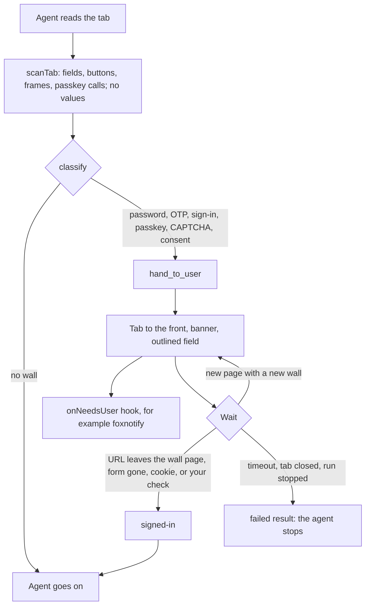
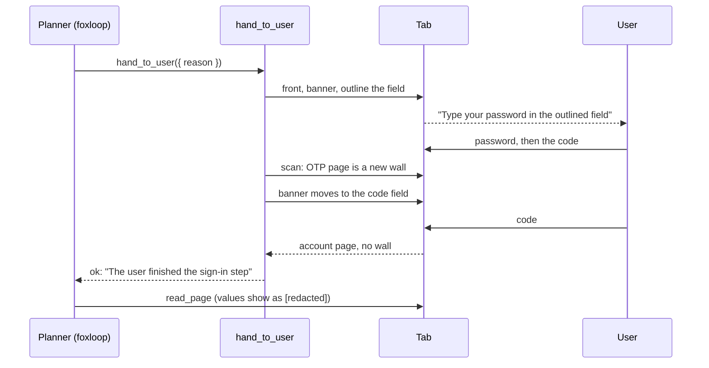
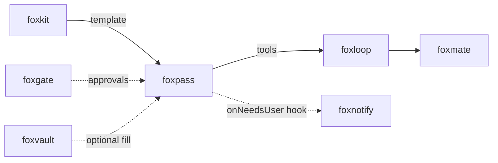

# foxpass

<p align="center">Hand logins and passkeys to the user, not the AI agent: the agent pauses, you sign in, the agent goes on.</p>

<p align="center">
  <a href="https://github.com/pooriaarab/foxpass/actions"></a>
  <a href="LICENSE"></a>
</p>

foxpass is for browser agents in Firefox. When the agent's task reaches a
sign-in step, foxpass names it: a password field, a one-time code (OTP), a
sign-in form, a passkey (WebAuthn) request, a CAPTCHA, or an OAuth consent
screen. It pauses the agent, brings the tab to the front, outlines the field,
and tells the user what to do. When the user is signed in, the agent goes on.

foxpass is a handoff, not an autofiller. A Firefox extension cannot read the
passwords that Firefox saves, and it cannot do a passkey ceremony for the
user. foxpass does not try. The agent never gets a typed password, a code,
or a passkey result: what the agent reads shows those values as `[redacted]`.

## Install

```bash
npm i foxpass
```

## Example

This part runs in Node 24 or later as written. It needs no browser.

```js
import { classify, redactSnapshot } from "foxpass";

// A page scan, as scanTab reads it from a tab. It holds no field values.
const field = { tag: "input", autocomplete: "", name: "", id: "", label: "", placeholder: "", inputMode: "", maxLength: -1, visible: true, filled: false, form: 0 };
const scan = {
  url: "https://bank.example/login",
  title: "Sign in",
  headings: ["Sign in"],
  fields: [{ ...field, selector: "#email", type: "email", name: "email" }, { ...field, selector: "#pw", type: "password", autocomplete: "current-password" }],
  buttons: [{ text: "Sign in", form: 0, visible: true }],
  frames: [],
  captchaMarks: [],
  webauthn: [],
};
console.log(classify(scan));
// [ { kind: 'password', reason: 'a visible password field', selector: '#pw', host: 'bank.example' } ]

// A snapshot from any reader, for example foxpaw. Secret values go.
const snapshot = { text: "Code 424242 sent", controls: [{ autocomplete: "one-time-code", value: "424242" }, { type: "search", value: "loans" }] };
console.log(redactSnapshot(snapshot));
// { text: 'Code [redacted] sent', controls: [ { autocomplete: 'one-time-code', value: '[redacted]' }, { type: 'search', value: 'loans' } ] }
```

In a Firefox extension, the background page scans a tab and hands the wall to
the user. The extension needs the permissions `scripting` and `webNavigation`,
and host access to the site.

```js
import { createHandoff, registerWebAuthnObserver, scanTab } from "foxpass";

// observer.js is a file you bundle that runs: import { observeWebAuthn } from "foxpass"; observeWebAuthn();
await registerWebAuthnObserver(browser, { js: "observer.js" });
const handoff = createHandoff({ browser, onNeedsUser: (notice) => console.log(notice.message) });

const { walls } = await scanTab(browser, tabId);
if (walls.length) {
  const result = await handoff.toUser({ tabId, walls });
  // { status: "signed-in", signal: "url-changed", host: "bank.example" }, or a timeout, a closed tab...
}
```

With [foxloop](https://github.com/pooriaarab/foxloop), give the planner the two
tools. `hand_to_user` holds the run while the user signs in.

```js
import { createFoxgate } from "foxgate";
import { createLoop, toolSpecs } from "foxloop";
import { handoffTool, readPageTool } from "foxpass";

const tools = [readPageTool({ browser, tabId: () => tabId }), handoffTool({ handoff, browser, tabId: () => tabId })];
const { gate, host } = createFoxgate({ tools: toolSpecs(tools) });
await host.addGrant({ scope: "read", domains: ["bank.example"] });
for await (const event of createLoop({ mind, gate, tools }).run("Read my balance.")) console.log(event.type);
```

## Use cases

| Who | What they build | How foxpass helps |
|---|---|---|
| A browser agent author (for example foxmate) | An agent that does tasks on sites where the user has an account | The agent stops at the sign-in step instead of failing or asking for the password. The user signs in, and the run goes on. |
| A developer on any agent framework | A tool loop that reads pages and fills forms | `redactSnapshot` takes the password, code, and card values out of any page snapshot before it goes to the model or a log. |
| An automation or QA engineer | Scripts that run on staging sites with 2FA | The script hands the OTP or passkey step to the person at the keyboard, and goes on when the page shows the account. |
| A notification app author (for example foxnotify) | Alerts on the desktop or the phone when an agent waits | The `onNeedsUser` hook gets the step kind, the host, and the words to show. foxpass does not depend on the app. |
| A password manager author | A fill button that an agent can ask for | `fillWall` fills a foxvault secret only into a field that the scan found as a sign-in step, after the user approves the exact host and field. |
| A security reviewer | A check that an agent never saw a secret | The scan and the snapshot never hold typed values. The E2E test looks for the typed password and code in every planner message. |

## How it works



1. `scanTab` runs a bundled function in the top document of the tab. It reads
   each field's type, `autocomplete`, name, label, and size, and if it is
   empty. It never reads a value.
2. `observeWebAuthn` runs in the page world at `document_start`. It wraps
   `navigator.credentials.get` and `create`, calls the real function with the
   same arguments, and returns the same promise. It records the kind, the RP
   ID, and the end state, never the result.
3. `classify` names each wall with a reason, for example
   `autocomplete=one-time-code` or `a pending passkey request (RP ID bank.example)`.
4. `createHandoff().toUser()` shows a banner, outlines the field, and checks
   the tab every 500 ms. Two scans in a row must agree before it says
   `signed-in`, so a page that still draws its form does not count.
5. `readTab` masks secret values in the page, so they never leave it, and
   runs `redactSnapshot` again on the result.



Every failure mode has a test: see [docs/failure-modes.md](docs/failure-modes.md).

## API

foxpass is a library. It has no CLI and no MCP server: every part needs a
live tab in Firefox, and the user at that tab.

### Classify and read

| Export | What it does |
|---|---|
| `classify(scan)` | Returns `Wall[]`: `{ kind, reason, selector?, host }`, in the order `webauthn`, `captcha`, `oauth-consent`, `otp`, `password`, `sign-in`. Throws `FoxpassError` `bad-scan` for a scan of the wrong shape. |
| `scanTab(browser, tabId)` | Returns `{ scan, walls, documentId? }` for the top document. |
| `readTab(browser, tabId)` | Returns a `PageSnapshot` for the agent: the URL, the title, up to 4000 characters of text, and the fields, with secret values `[redacted]`. |
| `redactSnapshot(snapshot)` | Returns a copy with each password, OTP, `cc-number`, `cc-csc`, or `secret: true` value as `[redacted]`. It replaces values of 4 or more characters in every other string too. Fields come from `controls` (foxpaw) and `fields`. |
| `isSecretField(field)`, `REDACTED` | The rule that `redactSnapshot` uses, and the text `[redacted]`. |
| `scanPage()`, `observeWebAuthn()` | The page functions. Bundle `observeWebAuthn` into the file that `registerWebAuthnObserver` names. |
| `registerWebAuthnObserver(browser, { js, matches? })` | Registers `js` as a `MAIN` world content script at `document_start`. Default matches: `http://*/*` and `https://*/*`. |

### Hand off

`createHandoff(options)` returns `{ toUser(request), waiting() }`.

| Option | Default | What it does |
|---|---|---|
| `browser` | required | `tabs`, `windows`, `scripting`, `webNavigation`, and `cookies` for the cookie signal. In Firefox, pass `browser`. |
| `timeoutMs` | 5 minutes | How long the user has. 1 s to 30 min, else `bad-option`. |
| `pollMs` | 500 | How often foxpass checks the tab. 100 ms to 10 s. |
| `onNeedsUser` | none | `(notice) => void`. `notice` has `tabId`, `host`, `kind`, `message`, and `walls`. If it throws, the handoff goes on. |
| `onEvent` | none | Gets `paused`, `wall-changed`, `resumed`, `ended`, and `notify-failed`, `highlight-failed`, `check-failed`, `scan-failed`. Events hold no values. |

`toUser({ tabId, walls?, hosts?, cookie?, check?, signal?, timeoutMs? })`
returns one of:

- `{ status: "signed-in", signal, host }`. `signal` is `url-changed` (the tab
  left the wall page on the same host, or on a host in `hosts`, and the new
  page has no wall), `form-gone`, `cookie` (the cookie `{ url, name }`
  appeared or changed), or `check` (your function returned true).
- `{ status: "timeout" | "tab-closed" | "cancelled" | "busy" | "no-wall" }`.

`messageFor(wall)` gives the words that the banner shows.

### Agent tools

Both tools have the foxloop tool shape and scope `read`. foxpass does not
import foxloop.

| Export | What it does |
|---|---|
| `handoffTool({ handoff, browser, tabId, request? })` | `hand_to_user`. The model can pass only `reason` (200 characters at most). `signed-in` and `no-wall` are `ok: true`. The other statuses are failed results with a summary that says to stop. |
| `readPageTool({ browser, tabId, check? })` | `read_page`. The summary says if the page has a wall. The page goes in `untrusted`. `check(snapshot)` can return a foxloop check. |

### Fill from foxvault (optional)

`fillWall({ vault, handle, tabId, scan, wall, token? })` fills a
[foxvault](https://github.com/pooriaarab/foxvault) secret into a `password`,
`otp`, or `sign-in` field from `scan`. It returns `refused` `not-a-wall-field`
or `wrong-kind` for other fields. Then it calls `vault.fill` with the scanned
`documentId`: foxvault checks the secret's hosts, asks foxgate (the approval
shows the host and the selector), and refuses `page-changed` for a page that
changed after the scan.

### Demo extension

`extension/` is a demo for Firefox 153 and later. A small agent with fixed
rules (no AI model) reads a balance on a sample bank site in `demo/site/`.

```bash
pnpm install
pnpm site        # serves demo/site/ on http://localhost:8790
pnpm build:ext   # builds dist-ext/; load it from about:debugging
```

Open `http://localhost:8790/login.html`, open the foxpass popup, click
**Allow foxpass on this site**, reload the page, and click **Run the agent
here**. Sign in with `ada@example.com` and the password `correct horse`, then
type the code `424242`. The popup shows the balance.

### Tests

```bash
pnpm ci:local    # lint, typecheck, unit tests, build, web-ext lint, AMO listing check
pnpm e2e         # two Firefox E2E tests; they write artifacts/e2e-<date>.json and artifacts/e2e-passkey-<date>.json
```

`e2e/run.mjs` uses Puppeteer over WebDriver BiDi. The test acts as the user:
it types the password and the code after foxpass hands the step over.
`e2e/passkey.mjs` uses Marionette, because WebDriver BiDi has no WebAuthn
commands. Firefox first waits for a USB key, so the passkey request stays
pending. The test then adds a virtual authenticator and a passkey, and clicks
"Use a passkey".

## Firefox APIs used

| API | MDN | Why |
|---|---|---|
| `scripting.executeScript` with `documentIds` (Firefox 153+) | [executeScript](https://developer.mozilla.org/en-US/docs/Mozilla/Add-ons/WebExtensions/API/scripting/executeScript) | Run the scan, the snapshot, and the banner in one exact document. |
| `scripting.registerContentScripts` with `world: "MAIN"` (Firefox 128+) | [registerContentScripts](https://developer.mozilla.org/en-US/docs/Mozilla/Add-ons/WebExtensions/API/scripting/registerContentScripts) | Run the passkey observer in the page world before page scripts. |
| `scripting.getRegisteredContentScripts`, `updateContentScripts` | [scripting](https://developer.mozilla.org/en-US/docs/Mozilla/Add-ons/WebExtensions/API/scripting) | Register the observer one time. |
| `webNavigation.getFrame` | [getFrame](https://developer.mozilla.org/en-US/docs/Mozilla/Add-ons/WebExtensions/API/webNavigation/getFrame) | Get the `documentId` of the top document. |
| `tabs.get`, `tabs.update`, `windows.update` | [tabs](https://developer.mozilla.org/en-US/docs/Mozilla/Add-ons/WebExtensions/API/tabs) | Read the tab address and status, and bring the tab and its window to the front. |
| `cookies.get` | [cookies.get](https://developer.mozilla.org/en-US/docs/Mozilla/Add-ons/WebExtensions/API/cookies/get) | The cookie sign-in signal. |
| `CredentialsContainer.get`, `create` | [CredentialsContainer](https://developer.mozilla.org/en-US/docs/Web/API/CredentialsContainer) | Observed only. foxpass passes each call through unchanged. |
| `Element.checkVisibility`, `getBoundingClientRect` | [checkVisibility](https://developer.mozilla.org/en-US/docs/Web/API/Element/checkVisibility) | Count only visible fields, so a hidden trap field is not a wall. |
| `Element.attachShadow` | [attachShadow](https://developer.mozilla.org/en-US/docs/Web/API/Element/attachShadow) | Keep the banner style apart from the page style. |
| `CSS.escape` | [CSS.escape](https://developer.mozilla.org/en-US/docs/Web/API/CSS/escape_static) | Make a selector for each field. |
| `permissions.request`, `permissions.contains`, `activeTab` | [permissions](https://developer.mozilla.org/en-US/docs/Mozilla/Add-ons/WebExtensions/API/permissions) | Ask for one site at a time. Demo only. |
| `tabs.query`, `tabs.reload` | [tabs.query](https://developer.mozilla.org/en-US/docs/Mozilla/Add-ons/WebExtensions/API/tabs/query) | Find the web tab for the popup. Demo only. |
| `action.setBadgeText`, `setBadgeBackgroundColor` | [action](https://developer.mozilla.org/en-US/docs/Mozilla/Add-ons/WebExtensions/API/action) | Show a badge while the agent waits. Demo only. |
| `runtime.sendMessage`, `runtime.onMessage` | [runtime](https://developer.mozilla.org/en-US/docs/Mozilla/Add-ons/WebExtensions/API/runtime) | The popup talks to the background page. Demo only. |

## Limits

- foxpass cannot read the passwords that Firefox saves, and it cannot finish
  a passkey ceremony. The user does both.
- The detection rules are heuristics. A site that names its fields in an odd
  way, draws its form in a canvas, or puts it in an iframe can hide a wall.
  The scan reads the top document only.
- A page can see the observer: the wrapped functions and the
  `data-foxpass-webauthn` attribute are visible to page scripts. A page can
  remove the record, and then foxpass misses its passkey call. A page can
  fake a record, and then foxpass starts a handoff with no real request.
- A conditional (autofill) passkey request alone is not a wall.
- The handoff waits in the memory of the background page. When Firefox
  unloads the event page, the wait stops. Keep the wait short, or keep the
  task state with your own store.
- A sign-in that ends on a page that has a sign-in form (for example a
  "sign in to another account" page) does not count as signed in. Use
  `cookie` or `check` for such a site.
- `redactSnapshot` replaces values exactly. It does not find a value that a
  page changed in case, cut, or encoded.
- The demo agent has fixed rules. It is not a model, and it knows only the
  sample bank site. The demo keeps its foxvault secret and its approvals in
  memory.
- The passkey E2E test needs a Firefox that waits for a USB key when no key
  is there. If Firefox fails the request at once, the test cannot see a
  pending call.

## Part of the fox primitives



foxpass has no runtime dependency. Its tools have the foxloop tool shape,
`fillWall` takes a foxvault vault, and the vault asks foxgate. The demo uses
all three from npm. foxnotify can use the `onNeedsUser` hook.

## License

[MIT](LICENSE)
